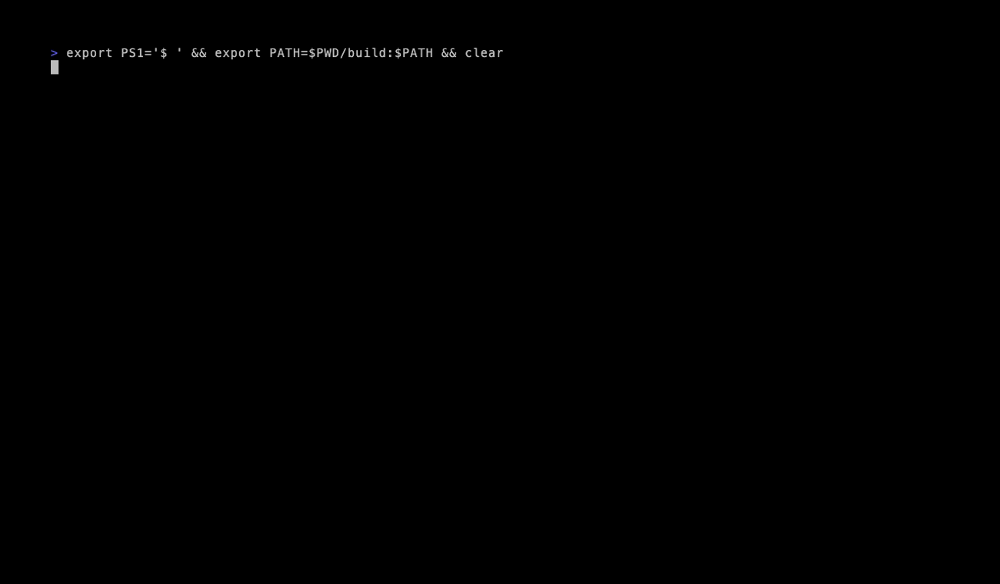
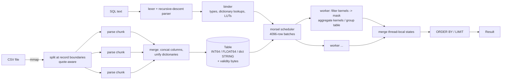

# vecq

Run SQL directly on large CSV files. vecq loads a CSV into typed, dictionary-encoded columns in parallel and runs queries with vectorized, morsel-parallel operators, using hand-written ARM NEON kernels on Apple silicon.

[](https://github.com/eshaan2418/vecq/actions/workflows/ci.yml)
[](LICENSE)




## Why this exists

Exploring a multi-gigabyte CSV export usually takes a detour. You import it into SQLite (slow, and every column comes in as TEXT unless you write a schema), load it into pandas (memory-hungry), or stand up a real analytics database. Often you only want a few `GROUP BY`s. vecq goes straight from the file to answers. On a 10M-row, 434 MB CSV it loads in about 0.2 s, and typical filter/aggregate queries finish in a few milliseconds. The project also works as a compact, readable reference for how a vectorized columnar engine fits together: tokenizer to kernels in under 3,000 lines.

## Highlights

- **Parallel, quote-correct CSV loading.** The file is mmap'd and split at record boundaries. When the file contains quotes, one sequential pass tracks quote state so no chunk starts inside a quoted field with an embedded newline. Chunks are parsed on all cores into typed columns and per-chunk dictionaries, then merged. A test checks that the parallel parse is byte-identical to a serial one.
- **Type inference with safe promotion.** Types are inferred from a sample. If a later value doesn't fit, for example a `3.5` deep inside an `INT64` column, the column is promoted (INT64 → FLOAT64 → STRING) and re-parsed, so data is never silently truncated.
- **NEON kernels over byte masks.** Filters produce one mask byte per row. Comparisons evaluate 16 rows per iteration and narrow the 64-bit lane masks with a `vmovn` tree. Aggregates sign-extend 8 mask bytes into 64-bit lane masks and AND them into the values, so there are no branches, and four independent accumulators hide FP latency.
- **Morsel-driven parallelism.** Workers pull 4096-row batches from an atomic counter, aggregate into thread-local states (a dense array for single string keys, an open-addressing hash table otherwise) and merge at the end.
- **Dictionary-aware predicates.** `=`/`!=` on strings becomes a NEON integer compare on dictionary codes. `<`, `>`, `LIKE` and `NOT LIKE` are evaluated once per distinct value into a lookup table and then gathered per row.
- **Differential testing.** 3,000 random queries per run (with NULLs, OR/AND trees, LIKE, BETWEEN, multi-key GROUP BY) are checked against an independent row-at-a-time interpreter. Each query runs under NEON and scalar kernels, 1–8 threads, and batch sizes from 16 to 4096.

## Quick start

Requires CMake ≥ 3.20, Ninja and a C++20 compiler. Tested with Apple clang 21 (macOS) and the Ubuntu 24.04 clang in CI. GoogleTest and Google Benchmark are fetched by CMake.

```sh
git clone https://github.com/eshaan2418/vecq && cd vecq
make build test          # Release build + 41 tests
make demo                # generates a 2M-row CSV and runs sample queries
```

macOS: `brew install cmake ninja`. Debian/Ubuntu: `sudo apt install cmake ninja-build clang`.

## Usage

```sh
vecq [options] <file.csv> ["SQL"]
```

The table name in `FROM` is arbitrary. Without a query, vecq reads one query per line from stdin and keeps the table loaded, which works well for interactive exploration (`vecq data.csv`, then type queries at the `vecq>` prompt).

```sh
$ vecq --schema trips.csv
trip_id                  INT64
vendor                   STRING   (4 distinct)
pickup_hour              INT64
passenger_count          INT64    nullable
distance                 FLOAT64
fare                     FLOAT64
tip                      FLOAT64
payment                  STRING   (5 distinct)
zone                     STRING   (260 distinct)

$ vecq trips.csv "SELECT vendor, pickup_hour, MAX(fare) FROM t
                  WHERE payment = 'card' AND zone LIKE 'Z1%'
                  GROUP BY vendor, pickup_hour ORDER BY 3 DESC LIMIT 3"

$ vecq --csv trips.csv "SELECT * FROM t WHERE passenger_count IS NULL LIMIT 100" > nulls.csv
```

| Option | Meaning |
|---|---|
| `-t, --threads N` | worker threads for loading and queries (default: all cores) |
| `--no-simd` | use the portable kernels instead of NEON |
| `--csv` | print results as CSV (round-trip float formatting) |
| `--timing` | print load and query times to stderr |
| `--repeat N` | run each query N times (benchmarking) |
| `--schema` | print inferred column types and exit |
| `-d, --delim C` | field delimiter (`\t` for TSV) |
| `--no-header` | first row is data; columns are named `c1..cN` |

**Supported SQL.** `SELECT` with columns, `*`, `COUNT(*)`, `COUNT/SUM/AVG/MIN/MAX(col)` and `AS` aliases. `WHERE` with `AND`/`OR`/parentheses, `= != <> < <= > >=` (literal on either side), `[NOT] BETWEEN`, `[NOT] LIKE` (`%`, `_`; case-sensitive), and `IS [NOT] NULL`. Then `GROUP BY` (up to 4 columns), `ORDER BY` by column, alias, aggregate or ordinal with `ASC`/`DESC`, and `LIMIT`.

As a library:

```cpp
#include "vecq/csv.h"
#include "vecq/exec.h"

vecq::Table t = vecq::load_csv("trips.csv");
vecq::Result r = vecq::query(t, "SELECT payment, AVG(tip) FROM t GROUP BY payment");
std::cout << vecq::format_table(r);
```

## Architecture



1. **Loading** (`src/csv.cpp`). Header and type inference come first, then the body is split into chunks of at least 1 MB. Each chunk is tokenized by a small RFC 4180 reader (quotes, `""` escapes, CRLF, BOM, blank lines) directly into typed buffers and a local string dictionary. Merging concatenates the buffers in parallel and remaps local dictionary codes to a global, first-appearance-ordered dictionary.
2. **Parsing and binding** (`src/sql.cpp`, `src/exec.cpp`). The parser produces an AST. The binder resolves columns and rewrites predicates into kernel calls. `int_col > 2.5` becomes `int_col >= 3`, so the INT64 kernel runs without converting the column. String equality becomes a code compare, and string ranges or LIKE patterns become a per-dictionary-entry lookup table.
3. **Execution**. Each worker evaluates the predicate tree for a batch into a byte mask (`AND`/`OR` are mask ops; column validity is ANDed in, so comparisons with NULL are never true). Ungrouped aggregates consume the mask directly through masked NEON kernels. Grouped aggregates convert the mask into a selection vector, map rows to group ids, and update accumulators in one tight loop per aggregate.
4. **Kernels** (`src/kernels_neon.cpp`, `src/kernels_scalar.cpp`). The same API has two implementations behind a runtime switch, so one binary can benchmark both.

More detail is in [docs/DESIGN.md](docs/DESIGN.md).

## Benchmarks

**Hardware:** Apple M5 Pro (18 cores), 48 GB RAM, macOS 27.0.1. **Compiler:** Apple clang 21.0.0, `-O3` (CMake Release). **Baseline:** SQLite 3.54.0, in-memory database with a typed schema.

### End to end: 10M rows, 434 MB CSV

Data comes from `vecq-gen 10000000 42` (synthetic ride trips: 9 columns, 1% NULLs in `passenger_count`). For every query, vecq's output is compared with SQLite's before any time is recorded. Query time excludes loading for both engines. Times are medians of 7 runs, in milliseconds.

| Query | SQLite | vecq NEON 9 threads | vecq NEON 1 thread | vecq scalar 1 thread |
|---|---:|---:|---:|---:|
| Q1 `COUNT(*) WHERE fare > 20` | 205.81 | 0.50 | 1.23 | 1.32 |
| Q2 `SUM, AVG` with a 2-predicate filter | 305.13 | 1.73 | 5.20 | 12.85 |
| Q3 `GROUP BY payment` (5 groups) | 2009.71 | 4.67 | 37.51 | 39.22 |
| Q4 filter + `GROUP BY zone` + top 5 | 702.48 | 1.39 | 6.27 | 6.17 |
| Q5 string filter + 2-key `GROUP BY` | 2613.56 | 8.11 | 67.42 | 66.67 |

Load time: SQLite `.import` 9.3 s; vecq 0.22 s with 9 threads and 1.20 s with 1 thread. Peak resident memory for a vecq load plus query is 2.03 GB, which includes the 434 MB mmap'd file (`bench/results/peak_rss.txt`).

Reproduce with `make bench-e2e`. Full SQL and the raw numbers are in [`bench/results/e2e.json`](bench/results/e2e.json).

**How to read this.** SQLite is a general-purpose, row-oriented, transactional engine that interprets bytecode one row at a time. vecq is a read-only, in-memory column store, so the 100x+ gaps reflect architecture more than cleverness. The comparison is still the practical one: it is what you would otherwise do with a CSV. The more informative columns are the vecq ones. Going from 1 to 9 threads gives 2.5–8.3x. Hand-written NEON beats the portable kernels by 2.5x on Q2, where the masked floating-point sum dominates, and makes no measurable difference elsewhere, because those queries are bound by group-by hashing, which is scalar code.

### Kernels: NEON vs portable C++

Google Benchmark, median of 5 repetitions, 50% random selection mask. Timings are for one 4096-row batch (L1-resident) and for a 16M-row column (DRAM).

| Kernel | rows | portable (µs) | NEON (µs) | speedup |
|---|---:|---:|---:|---:|
| masked sum, f64 | 4096 | 1.994 | 0.446 | 4.47x |
| masked sum, f64 | 16M | 8392.637 | 1900.415 | 4.42x |
| masked max, f64 | 4096 | 1.828 | 0.474 | 3.86x |
| masked max, f64 | 16M | 7541.311 | 2001.296 | 3.77x |
| mask popcount | 4096 | 0.189 | 0.122 | 1.55x |
| masked sum, i64 | 4096 | 0.482 | 0.443 | 1.09x |
| compare i64 → mask | 4096 | 0.218 | 0.220 | 0.99x |
| compare f64 → mask | 4096 | 0.220 | 0.220 | 1.00x |
| compare u32 (dict code) → mask | 4096 | 0.103 | 0.124 | 0.83x |
| mask → selection vector | 4096 | 0.921 | 0.962 | 0.96x |

The full table is in [`bench/results/kernels.md`](bench/results/kernels.md). Reproduce with `make bench-kernels`.

The portable kernels are deliberately strong baselines: branch-free, and written so clang can auto-vectorize them. Clang does vectorize the comparisons and integer sums, which is why NEON ties there. Floating-point reductions can't be auto-vectorized without `-ffast-math`, because reassociating FP adds changes results; the NEON version accepts a different summation order and wins 4x. An earlier version of the portable kernels used `m ? x : 0.0`, which clang compiled to a branch per element. On random masks over large columns, mispredictions made it several times slower again, an unfair comparison, so it was rewritten as a bitwise select.

**Limitations of these benchmarks.** The data is synthetic and moderately sized. The generator clamps the tail of the zone distribution into `Z259`, which is why that zone stands out in the demo. All runs are warm-cache and on a single machine. The query set is aggregation-heavy, which suits a column store. SQLite timings include its result formatting, and vecq's do not include printing.

## Design decisions and trade-offs

- **Byte masks, not bitmaps.** One byte per row costs 8x the memory of a bitmap, but a 4096-row batch mask is still only 4 KB, so it stays in L1. Byte masks make every kernel a straight 16-lane NEON loop with no bit-shuffling. Bitmaps would win at very low selectivity, where skipping words matters.
- **Fully in-memory, load on every run.** This is simpler and fast enough: 0.22 s for 434 MB. A persistent columnar cache, or Parquet input, is the obvious next step for repeated queries over the same file.
- **Dictionary encoding for every string column.** This makes string GROUP BY and equality nearly free and keeps rows fixed-width. It costs memory on high-cardinality columns like free text, where the dictionary approaches the raw data size.
- **Batch-level predicates, no short-circuiting.** Both sides of `AND` are always evaluated over the whole batch, because a branch-free full-batch compare costs less than tracking a shrinking selection.
- **Scalar group-by.** Grouped aggregation maps rows to group ids through a hash table or dense array, then updates accumulators row by row. Vectorizing this, for example with partitioned aggregation, is where the remaining time in Q3 and Q5 goes.
- **Rejected: JIT/codegen.** Compiling queries would remove interpretation overhead between operators, but at 4096-row batches that overhead is already amortized. It would also add a large dependency.

## Testing

- **Differential tests** (`tests/differential_test.cpp`). Random tables with NULLs in three columns and 600 random queries per configuration are checked against an independent reference interpreter. There are five configurations: NEON and scalar kernels, 1/3/4/8 threads, batch sizes 16/64/1000/4096. Planting a one-character bug (`vcleq` changed to `vcltq` in one kernel) fails 4 test cases.
- **Kernel equivalence**. NEON and scalar results must agree on lengths 0–8165 (all tail paths), at selection densities of 0/1/50/100%, on INT64_MIN/MAX and on NaN.
- **CSV**. Covers quotes, escapes, embedded newlines, CRLF/BOM, NULLs, short rows, type promotion, malformed input, and parallel-vs-serial equality with tiny chunks.
- **Sanitizers**. The full suite runs under ASan+UBSan and under TSan (`make sanitize`), both locally and in CI.
- **CI** runs on macOS arm64, Linux arm64 (NEON) and Linux x86-64 (portable kernels), with `-Werror -Wconversion -Wshadow` and a pinned clang-format check.

## Limitations and roadmap

- No joins, subqueries, `DISTINCT`, `HAVING`, or expressions in `SELECT` (for example `SUM(fare + tip)`).
- `NOT` is only supported as part of `NOT LIKE`, `NOT BETWEEN` and `IS NOT NULL`.
- `MIN`/`MAX` on string columns are not supported. `LIKE` is case-sensitive (SQLite's is not).
- The whole file must fit in memory, and there is no streaming or out-of-core mode.
- Integer `SUM` wraps on overflow instead of raising an error.
- Roadmap: vectorized group-by (radix-partitioned), Parquet input, a NEON CSV tokenizer, and a persistent column cache.

## Project structure

```
include/vecq/   public headers: table, kernels, csv, sql, exec, parallel
src/            kernels_neon.cpp, kernels_scalar.cpp, csv.cpp, sql.cpp, exec.cpp
tools/          vecq CLI, vecq-gen synthetic data generator
tests/          GoogleTest suites incl. differential testing
bench/          kernel micro-benchmarks, e2e.py (vs SQLite), results/
docs/           DESIGN.md, demo.gif
```

## License

MIT. See [LICENSE](LICENSE).
